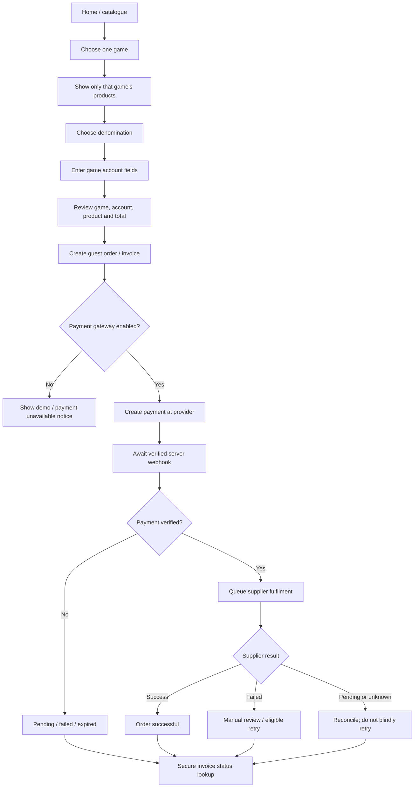
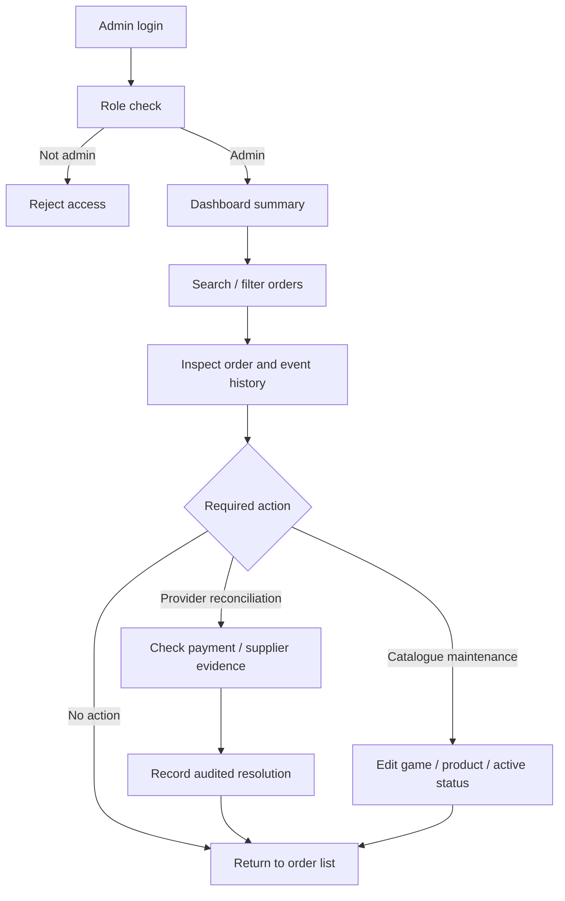
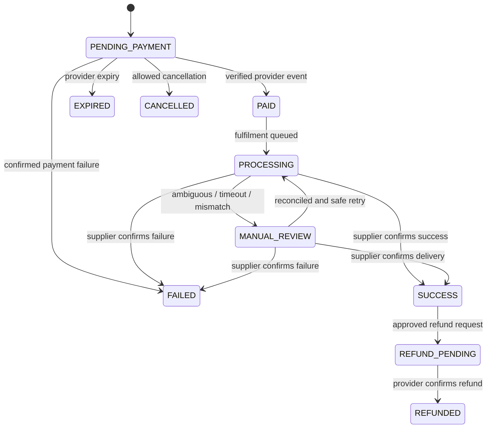

# System & UI/UX Design — TopUpKita

**Status:** Design baseline v1.0  
**Phase:** 2 — System & UI/UX Design  
**Date:** 2026-11-16  
**Basis:** `docs/requirements-analysis.md` and the current Express + SQLite prototype.

## 1. Design principles

- Guest checkout is the default; sign-in is optional and only needed for account history.
- One game context per product selection. A denomination list is always filtered to one game.
- The backend is authoritative for product availability and price.
- Payment success and fulfilment success are separate facts and separate state transitions.
- A customer-facing invoice is not proof of payment or delivery.
- Provider-specific fields, signatures, SKU mappings, and callbacks remain adapter contracts until a real provider is selected and tested.
- The current seeded catalogue is demo data, not live stock or supplier pricing.

## 2. Roles and navigation

### Guest customer
Home → select game → select denomination → enter game account details → review → create invoice → payment instructions (only when a gateway is enabled) → invoice status lookup.

### Optional registered customer
All guest steps remain available. Login only adds an authenticated order-history view.

### Administrator
Admin login → dashboard → search/filter orders → inspect invoice and event history → perform permitted manual review actions → manage games/products and integration configuration.

## 3. Customer journey



## 4. Admin journey



## 5. Page wireframes

Wireframes are structural, not final pixel-perfect artwork. Preserve the existing charcoal + gold TopUpKita visual direction.

### 5.1 Home / catalogue
- Header: TopUpKita brand, anchor navigation, optional login/history.
- Promo banner: short value proposition and CTA.
- Popular games: artwork tiles with game name.
- Game catalogue: selectable game cards.
- Nominal area: game-specific section. Selecting a game filters the products; never render another game's denominations under the selected game.
- PPOB section is separate from game top-ups.
- Footer: support, policies, operator identity (to be supplied).
- Persistent demo warning until payment and supplier integrations are live.

### 5.2 Game / nominal selection
- Game title and authorized artwork.
- Account-field instructions specific to the selected game.
- Nominal cards in a two-column mobile grid.
- Product name, denomination, price, and availability.
- Special passes/items visually separated from currency denominations.

### 5.3 Checkout review
1. Game account details: configured fields with labels, validation, and help text.
2. Selected nominal: product and price.
3. Order summary: subtotal, fees, discounts, total.
4. Confirmation: customer confirms destination and amount.
5. Submit creates an invoice; it does not mark the order paid.

### 5.4 Payment / invoice
- Invoice number, creation time, game, product, masked destination details, amount, payment status.
- Show provider instructions only after a real provider returns a valid charge/payment URL/QR payload.
- Show clear pending/expired/failed/paid/processing/success states.
- Guest lookup requires invoice plus a separate verification factor (e.g. one-time secret or verified contact). Do not expose an invoice by sequential ID alone.

### 5.5 Admin dashboard
- KPI cards: orders, gross order value, customer count; label demo metrics clearly.
- Search and filters: invoice, date, game, status.
- Order detail: target fields, amount, payment reference, supplier reference, status history, timestamps.
- Catalogue management: games, products, active state, price, supplier SKU mapping.
- Integration health: last webhook, supplier response, error queue; secrets are masked and never returned to browser.
- Manual actions require role authorization, evidence, reason, and audit event.

## 6. Logical data model

The current prototype has `users`, `products`, and `orders`. The target production model is normalized as follows.

```mermaid
erDiagram
  USERS ||--o{ ORDERS : optionally_owns
  GAMES ||--o{ PRODUCTS : contains
  ORDERS ||--|{ ORDER_ITEMS : includes
  PRODUCTS ||--o{ ORDER_ITEMS : selected_as
  ORDERS ||--o{ PAYMENTS : has
  ORDERS ||--o{ FULFILLMENT_ATTEMPTS : triggers
  ORDERS ||--o{ ORDER_STATUS_HISTORY : records
  USERS ||--o{ ADMIN_AUDIT_LOGS : performs
  ORDERS ||--o{ ADMIN_AUDIT_LOGS : concerns

  USERS {
    int id PK
    string name
    string email UK
    string password_hash
    string role
  }
  GAMES {
    int id PK
    string slug UK
    string name
    string publisher
    string artwork_url
    boolean active
  }
  PRODUCTS {
    int id PK
    int game_id FK
    string provider_code UK
    string name
    int price
    int supplier_cost
    boolean active
  }
  ORDERS {
    int id PK
    string invoice UK
    int user_id FK nullable
    string guest_lookup_hash
    int amount
    string status
    string idempotency_key UK
    datetime created_at
    datetime updated_at
  }
  ORDER_ITEMS {
    int id PK
    int order_id FK
    int product_id FK
    string target_data_json
    int unit_price
    int quantity
  }
  PAYMENTS {
    int id PK
    int order_id FK
    string provider
    string provider_reference
    string status
    int amount
    string raw_event_hash
    datetime verified_at
  }
  FULFILLMENT_ATTEMPTS {
    int id PK
    int order_id FK
    string supplier
    string supplier_reference
    string sku
    string status
    string response_summary
    datetime created_at
  }
  ORDER_STATUS_HISTORY {
    int id PK
    int order_id FK
    string from_status
    string to_status
    string actor
    string reason
    datetime created_at
  }
  ADMIN_AUDIT_LOGS {
    int id PK
    int user_id FK
    int order_id FK nullable
    string action
    string reason
    datetime created_at
  }
```

### Important data rules
- `orders.user_id` is nullable for guest orders.
- Destination data belongs to the order item and is treated as sensitive operational data.
- Store only the minimum customer contact data needed for receipts/verification.
- Never store card data or payment credentials.
- Preserve provider/supplier event IDs and hashes for deduplication and reconciliation.
- Monetary values are integer IDR (rupiah), not floating point.
- A product belongs to exactly one game (PPOB items use a separate category/service model or a nullable game relation with explicit type).

## 7. Order state machine



Rules:
- Only a verified provider webhook or provider API reconciliation may transition payment to `PAID`.
- Only a supplier-confirmed result may transition fulfilment to `SUCCESS`.
- A customer redirect/return URL never changes payment state.
- Unknown supplier outcomes enter manual review and must be reconciled before retry.
- All transitions are transactional and append a status-history record.

## 8. API contract (target)

| Method | Endpoint | Purpose | Access |
|---|---|---|---|
| GET | `/api/games` | Active game catalogue | Public |
| GET | `/api/games/:slug/products` | Products for one game | Public |
| GET | `/api/products` | Current compatibility endpoint; later deprecate | Public |
| POST | `/api/orders` | Validate price + create guest invoice | Public, rate-limited |
| GET | `/api/orders/:invoice` | Secure invoice lookup | Invoice + verification factor |
| POST | `/api/orders/:invoice/verify` | Verify guest lookup token/contact | Public, rate-limited |
| GET | `/api/orders` | Optional signed-in order history | Customer |
| POST | `/api/payments/webhook/:provider` | Verify and process provider event | Provider signature |
| POST | `/api/suppliers/webhook/:supplier` | Verify supplier callback | Supplier signature |
| GET | `/api/admin/summary` | Dashboard metrics | Admin |
| GET | `/api/admin/orders` | Search/filter orders | Admin |
| GET | `/api/admin/orders/:invoice` | Order detail + history | Admin |
| PATCH | `/api/admin/products/:id` | Update catalogue | Admin |
| POST | `/api/admin/orders/:invoice/reconcile` | Evidence-based manual resolution | Admin + audit |

For the current prototype, some routes above are target contracts and are not yet implemented. Do not expose placeholder routes as working features.

## 9. Payment and fulfilment integration sequence

1. Backend creates an order with a server-calculated amount and an opaque guest lookup secret.
2. Backend requests a payment charge from the configured payment adapter.
3. Provider response is stored; customer sees the provider's payment instructions.
4. Provider calls the webhook endpoint.
5. Backend verifies signature, amount, invoice, event freshness, and duplicate event ID.
6. In one transaction, payment is marked paid and an outbox/fulfilment job is recorded.
7. Worker sends the mapped SKU and exact destination fields to supplier.
8. Supplier callback or status query is authenticated and reconciled.
9. Order is marked successful only on supplier confirmation.
10. Customer status lookup shows the latest state and safe status history.

Provider adapters must be disabled by default until credentials, webhook validation, sandbox tests, SKU mapping, and reconciliation are complete.

## 10. Security and operational design

- HTTPS only in production; secure, HttpOnly, SameSite cookies; rotate session on login.
- Strong admin password hashing, login rate limits, and admin-only middleware on every admin route.
- Validate all input server-side; parameterized SQL only.
- Rate-limit order creation and invoice lookup; add idempotency protection before accepting public traffic.
- Hash guest lookup tokens; never log raw tokens or secrets.
- Verify webhook signatures and reject replayed/duplicate events.
- Keep API secrets in server environment variables; never expose them to frontend bundles or logs.
- Back up the SQLite database and WAL safely; test restore. For scale/high write concurrency, plan migration to managed PostgreSQL.
- Monitor health endpoint, deployment state, failed payment events, supplier timeouts, and manual-review queue.

## 11. Current implementation delta

The existing prototype does not yet satisfy the full target design:
- Game grouping exists in frontend rendering but backend products still use a broad `category` field; a first-class game model and API filter are future work.
- Current checkout sends a combined target string; structured per-game destination fields are not yet persisted.
- Guest order insertion is intended, but the existing database migration and order routes require automated verification.
- Invoice lookup with a guest verification factor is not yet implemented.
- Payment adapter is disabled; no signed payment webhook is configured.
- Fulfilment remains manual/stubbed; no live supplier callback is configured.
- Admin currently has summary and order-list views; catalogue editing, order detail, filters, and audit trail are future work.
- Existing remote artwork URLs must be checked for availability and usage rights before production.

## 12. Phase 2 acceptance criteria

- Customer and admin journeys are documented.
- Home, game selection, checkout, invoice, and admin structures are specified.
- Guest-order data model and state machine are defined.
- Payment verification is explicitly separated from supplier fulfilment.
- API target contracts and security boundaries are documented.
- Provider-specific integrations remain disabled until selected and verified.

## 13. Next phase

Phase 3 — Implementation:
1. Fix runtime-blocking defects and guest-order SQL/migration issues.
2. Add safe order/invoice handling and validation within the existing architecture.
3. Add automated smoke tests for health, catalogue, guest checkout, auth/admin boundaries.
4. Keep demo payments clearly disabled; do not claim live top-up delivery.
